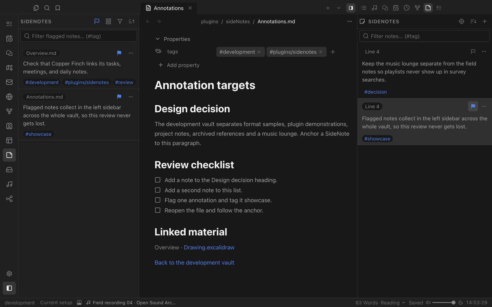

# SideNotes

Margin notes for everything you read. Anchor a note to a file, heading, line, PDF selection, web page or media position, and keep it in view next to the source.

## Notes beside the source

Open SideNotes in the right sidebar while you read and add a note for the current spot. Each note remembers where it belongs and shows its anchor, such as the line or heading it refers to. Notes follow their files when you rename or move them.

## Flag what matters

- Add tags to group related notes across your realm.
- Flag a note to collect it in the left sidebar, where flagged notes from every file stay together.
- Filter notes by text or `#tag`, and sort them.

## Aware of time

For audio and video, Aware mode shows the notes closest to the current playback position, so your comments surface exactly when the moment comes.

SideNotes also appear in Valley's search and in Graph View.
